# LordOS moving wallpapers

Short loops for LordOS, downloaded on demand from Settings → Wallpaper. Each clip fades its end into its start. Nothing here is upscaled or interpolated: frame rate and size never exceed the source's. Formats: HEVC first, H.264 for machines that decode only that in hardware.

LordOS verifies every file against the SHA-256 in `catalog.json`, whose copy ships in the signed system package.

Attribution is part of each license below. Clips under CC BY-SA stay under that license as edited here (share-alike), and each folder has a README with its author, license and source page. Each clip is an edit of its source: cropped, cut to a few seconds, the sound removed and the ends faded together. CC BY-SA clips are shared under the same license.

## Dynamic

| | Title | Author | License | Source | Sizes |
|---|---|---|---|---|---|
|  | Crystal Crown | Federico Pereira, LordOS | MIT, © LordOS | [source](https://lordos.org) | 1080p60 HEVC, 2160p60 HEVC, 1080p60 H264 |

## Landscape

| | Title | Author | License | Source | Sizes |
|---|---|---|---|---|---|
|  | Canyon clouds | Extemporalist | [CC0](http://creativecommons.org/publicdomain/zero/1.0/deed.en) | [source](https://commons.wikimedia.org/wiki/File:Timelapse_of_Clouds_over_Bellevue_Canyon.webm) | 1080p30 HEVC, 1080p30 H264 |
|  | Desert sunset | Joshua Tree National Park, U.S. National Park Service | Public domain | [source](https://commons.wikimedia.org/wiki/File:Timelapse_Joshua_Tree_Clouds_and_Sunset_Near_West_Entrance.webm) | 1080p30 HEVC, 1080p30 H264 |
|  | Last light | Extemporalist | [CC0](http://creativecommons.org/publicdomain/zero/1.0/deed.en) | [source](https://commons.wikimedia.org/wiki/File:Dying_Light_on_Okanagan_Mountain.webm) | 1080p24 HEVC, 1080p24 H264 |
| 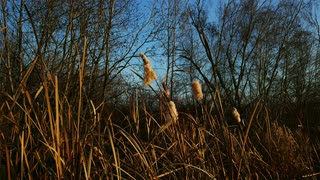 | Autumn reeds | Extemporalist | [CC0](http://creativecommons.org/publicdomain/zero/1.0/deed.en) | [source](https://commons.wikimedia.org/wiki/File:Autumn_Cattails_at_Sunset_in_East_Kelowna,_British_Columbia,_Canada.webm) | 1080p25 HEVC, 1080p25 H264 |
|  | Reservoir | Sillerkiil | [CC0](http://creativecommons.org/publicdomain/zero/1.0/deed.en) | [source](https://commons.wikimedia.org/wiki/File:Drone_video_of_Paunk%C3%BCla_water_reservoir_in_Estonia.webm) | 1080p30 HEVC, 1080p30 H264 |
| 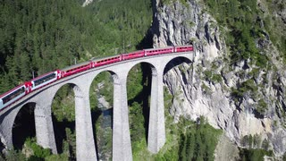 | Viaduct | Capricorn4049 | [CC BY-SA 4.0](https://creativecommons.org/licenses/by-sa/4.0) | [source](https://commons.wikimedia.org/wiki/File:Landwasserviadukt,_aerial_video.webm) | 1080p30 HEVC, 2160p30 HEVC, 1080p30 H264 |
| 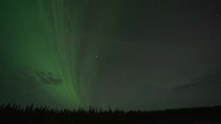 | Northern lights | NASA's Scientific Visualization Studio | Public domain | [source](https://commons.wikimedia.org/wiki/File:Alaskan_Aurora_Time_Lapse_(SVS15077).webm) | 1080p30 HEVC, 2160p30 HEVC, 1080p30 H264 |

## Urban

| | Title | Author | License | Source | Sizes |
|---|---|---|---|---|---|
| 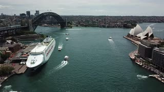 | Harbour city | Johnny Xmas | [CC BY 3.0](https://creativecommons.org/licenses/by/3.0) | [source](https://commons.wikimedia.org/wiki/File:Aerial_views_over_Circular_Quay_and_the_city_of_Sydney_Australia.webm) | 1080p24 HEVC, 2160p24 HEVC, 1080p24 H264 |
| 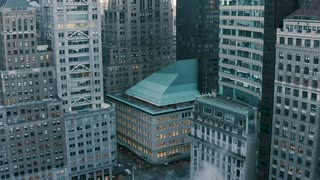 | Midtown | the Dronalist | [CC BY 3.0](https://creativecommons.org/licenses/by/3.0) | [source](https://commons.wikimedia.org/wiki/File:Aerial_views_of_Midtown_Manhattan,_New_York_City,_USA.webm) | 1080p24 HEVC, 2160p24 HEVC, 1080p24 H264 |
|  | Night flight | Evgeniy Starostin | [CC0](http://creativecommons.org/publicdomain/zero/1.0/deed.en) | [source](https://commons.wikimedia.org/wiki/File:Night_flight_over_Vladivostok_%E2%81%84_%D0%9D%D0%B0%D0%B4_%D0%9D%D0%BE%D1%87%D0%BD%D1%8B%D0%BC_%D0%92%D0%BB%D0%B0%D0%B4%D0%B8%D0%B2%D0%BE%D1%81%D1%82%D0%BE%D0%BA%D0%BE%D0%BC.webm) | 1080p30 HEVC, 2160p30 HEVC, 1080p30 H264 |
| 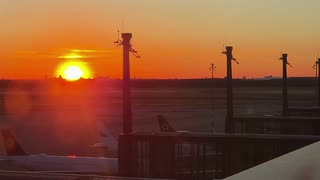 | Runway sunset | NutzerAusBerlin | [CC0](http://creativecommons.org/publicdomain/zero/1.0/deed.en) | [source](https://commons.wikimedia.org/wiki/File:Time-lapse_sunset_Berlin_Brandenburg_Airport.webm) | 1080p25 HEVC, 1080p25 H264 |
| 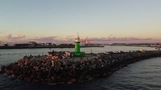 | Lighthouse | JamesBromberger | [CC0](http://creativecommons.org/publicdomain/zero/1.0/deed.en) | [source](https://commons.wikimedia.org/wiki/File:Orbit_around_Fremantle_South_Mole_Lighthouse_at_sunset.webm) | 1080p30 HEVC, 1080p30 H264 |

## Underwater

| | Title | Author | License | Source | Sizes |
|---|---|---|---|---|---|
|  | Ocean surface | Mostafameraji | [CC0](http://creativecommons.org/publicdomain/zero/1.0/deed.en) | [source](https://commons.wikimedia.org/wiki/File:Ocean_surface_waves_07.ogv) | 1080p25 HEVC, 1080p25 H264 |
|  | Jellyfish | Fastily | [CC BY-SA 4.0](https://creativecommons.org/licenses/by-sa/4.0) | [source](https://commons.wikimedia.org/wiki/File:Jellyfish_at_Monterey_Bay_Aquarium_9_2024-01-11.webm) | 1080p60 HEVC, 2160p60 HEVC, 1080p60 H264 |
| 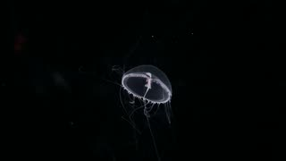 | Drifting jellyfish | Fastily | [CC BY-SA 4.0](https://creativecommons.org/licenses/by-sa/4.0) | [source](https://commons.wikimedia.org/wiki/File:Jellyfish_at_Monterey_Bay_Aquarium_5_2024-01-11.webm) | 1080p60 HEVC, 2160p60 HEVC, 1080p60 H264 |
| 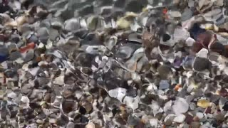 | Stream | jLasWilson | [CC0](http://creativecommons.org/publicdomain/zero/1.0/deed.en) | [source](https://commons.wikimedia.org/wiki/File:Running_Stream_Of_Water.webm) | 1080p25 HEVC, 1080p25 H264 |

## Earth

| | Title | Author | License | Source | Sizes |
|---|---|---|---|---|---|
| 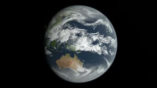 | Blue marble | NASA's Scientific Visualization Studio | Public domain | [source](https://commons.wikimedia.org/wiki/File:Spinning_Earth_with_clouds,_atmosphere,_and_night_lights_(SVS5570).webm) | 1080p60 HEVC, 2160p60 HEVC, 1080p60 H264 |
| 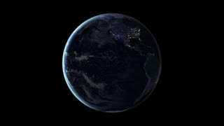 | Night lights | NASA's Goddard Space Flight Center | Public domain | [source](https://commons.wikimedia.org/wiki/File:BlackMarble_2016_rotating_globe_at_night.webm) | 1080p30 HEVC, 2160p30 HEVC, 1080p30 H264 |
|  | Orbit | NASA Johnson | Public domain | [source](https://commons.wikimedia.org/wiki/File:View_of_Planet_Earth_(4K).webm) | 1080p24 HEVC, 2160p24 HEVC, 1080p24 H264 |
|  | Aurora from space | NASA | Public domain | [source](https://commons.wikimedia.org/wiki/File:Aurora_Borealis_from_Space_(4K).webm) | 1080p30 HEVC, 2160p30 HEVC, 1080p30 H264 |
|  | Solar flares | NASA's Scientific Visualization Studio | Public domain | [source](https://commons.wikimedia.org/wiki/File:Large_Solar_Flares_Erupt_From_the_Sun_(SVS31361).webm) | 1080p12 HEVC, 2160p12 HEVC, 1080p12 H264 |

